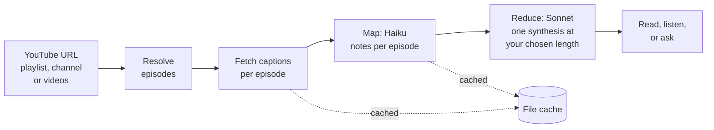

# podbite

Paste a podcast (a YouTube playlist, channel, or video URLs) → get a synthesis of the
**whole show** at the length you choose. Not per-episode summaries (Snipd does that),
not manual multi-source dumps (NotebookLM does that) — the cross-episode through-line
neither of them produces. Then listen to it read aloud, ask questions about an episode,
or read the full transcript.

This is a v0. It does the spine end-to-end. The hard extensions are deliberately deferred (see below).

---

## Run it (5 minutes)

```bash
brew install yt-dlp deno         # captions are fetched via yt-dlp (needs deno)
npm install
cp .env.example .env.local      # then paste your Anthropic key into .env.local
npm run dev
```

Open http://localhost:3000, paste a YouTube **playlist or channel URL** (or a few video
URLs separated by spaces/commas), pick Quick or Deep, hit Synthesize.

You need **one** key: `ANTHROPIC_API_KEY` from https://console.anthropic.com.
YouTube listing is keyless (via `youtubei.js`); captions are fetched with the keyless
`yt-dlp` binary (see "Known fragility" for why).

> **Pick a show that's on YouTube** for v0 — that's how you skip building an audio
> transcription engine. Captions come free from YouTube. Audio-only podcasts are the
> Day 2 problem.

---

## How it works

It's a **map-reduce summarization pipeline**: summarise each episode cheaply, then combine
all the summaries once with a stronger model.



- **Map step** (`lib/summarize.ts → summarizeEpisode`): one cheap **Haiku** call per
  episode produces dense structured notes. This is 90% of the token volume, so it runs
  on the cheap model — on purpose.
- **Reduce step** (`synthesize`): one **Sonnet** call takes all episode notes + a target
  word count and writes the cross-episode synthesis. Strong model, runs once.
- **Length targeting**: presets map to a word-count instruction + `max_tokens` budget.

### Cost — why it can't run away

Transcription is normally the cost driver; here YouTube gives captions free, so the only
spend is LLM tokens. The design keeps it bounded:

- **Transcribe/summarize once, cache forever** (`lib/cache.ts`). Re-reading a show at a
  different length only reruns the cheap reduce step. Re-running the same length is free.
- **Dead transcripts are cached too** (as `null`) so we never re-fetch episodes with no
  captions.
- For personal use (5–10 shows) this is single-digit dollars. To make overspend
  *impossible*, set a prepaid spend cap on your Anthropic key.

---

## What's deliberately deferred (Day 2+)

| Deferred | Why it's hard | Where it slots in |
|---|---|---|
| **Audio transcription** (non-YouTube podcasts) | Long audio is async — needs job queue + polling | new `fetchTranscript` backend behind the same interface |
| **True adjustable length (30m / 1h / 5h)** | A 5-hr read ≈ 75k words — exceeds one generation, needs chunked + stitched output | extend `synthesize` with a chunked reduce |
| **Whole back-catalog (100s of eps)** | Cost + a 2-level map-reduce (summarize the summaries) | add an intermediate reduce tier |
| **Shareable permalinks / discovery feed** | Storage + routing | swap file cache for a DB, add `/s/[id]` route |
| **Streaming progress (SSE)** | Nicer UX on long runs | stream from the API route |

---

## Files

```
app/page.tsx              UI (single column, editorial)
app/api/ingest/route.ts   orchestration + synthesis cache
app/api/ask/route.ts      Q&A on a single episode (reuses the transcript cache)
app/api/tts/route.ts      mp3 synthesis endpoint (cached, immutable)
lib/youtube.ts            resolve episodes (youtubei.js) + fetch captions (yt-dlp)  ← most fragile, isolated on purpose
lib/summarize.ts          map (Haiku) + reduce (Sonnet) + length targeting
lib/anthropic.ts          thin Messages API client (Haiku=map, Sonnet=reduce)
lib/tts.ts                OpenAI tts-1 client, chunked + cached
lib/cache.ts              file cache = the cost story
lib/types.ts              shared types
```

## Known fragility

`lib/youtube.ts` is the only file that talks to YouTube, and it's split across two
mechanisms on purpose:

- **Episode listing** uses `youtubei.js` (scrapes YouTube's internal API). Listing
  endpoints don't need attestation, so this is stable enough.
- **Captions** use the **`yt-dlp`** binary. As of 2025–26 YouTube requires a *PoToken*
  (a BotGuard proof-of-origin token) for caption fetches — without it the `timedtext`
  endpoint returns an empty `200` and the old `get_transcript` endpoint `400`s, so
  `youtubei.js` reports "no captions" for *every* video. `yt-dlp` solves the JS challenge
  itself (via `deno`) and returns real captions. This is the swap-in this README always
  anticipated. If captions stop working, update yt-dlp first: `brew upgrade yt-dlp`.

The official YouTube Data API is the other fallback for listing, but it can't serve
captions for videos you don't own, so it's not a drop-in for the caption path.
